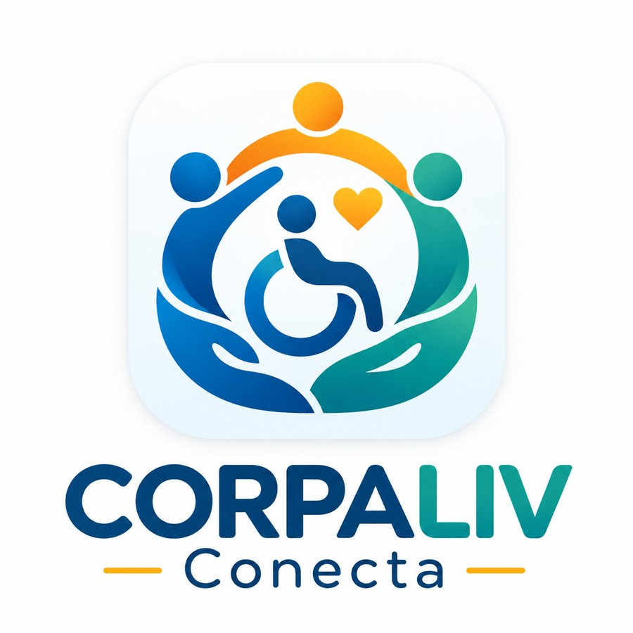

# CORPALIV Conecta



**CORPALIV Conecta** es una aplicación móvil Android que acerca a las personas a la labor de la **Corporación de Padres y Amigos por el Limitado Visual (CORPALIV)** y su red sociolaboral **Alba Lab**. Reúne información sobre educación, inclusión, programas, productos y servicios, y ofrece recorridos claros para conocer las iniciativas y expresar interés en participar.

> **Construyamos juntos un país sin barreras.**

## Objetivo

Facilitar el acceso a información institucional y conectar a personas, familias, colaboradores y empresas con las iniciativas de CORPALIV. La aplicación busca dar visibilidad al trabajo de la **Escuela Especial Jan Van Dijk** y de **Alba Lab**, así como presentar opciones de colaboración y contacto de forma sencilla y accesible.

## Funcionalidades

| Sección | Qué permite hacer |
| --- | --- |
| **Inicio** | Conocer CORPALIV, su propósito, trayectoria, programas, iniciativas de impacto y noticias enlazadas a fuentes institucionales. |
| **Programas** | Explorar iniciativas educativas, sociolaborales y de vinculación; abrir una ficha y acceder a la acción que corresponde a cada programa. |
| **Catálogo** | Consultar fichas de productos y servicios de Alba Lab, con descripciones y acciones diferenciadas. |
| **Participar** | Explorar formas de apoyar, contactar a la organización o continuar hacia los canales oficiales de donación y postulación. |
| **Colaboración y consultas** | Completar un formulario contextual; cuando se consulta un producto o programa, su nombre se conserva en la solicitud. |
| **Mis solicitudes** | Ver los registros guardados, crear nuevos y eliminarlos con confirmación. |

### Formularios e interacción

- Validación de nombre, correo electrónico, tipo de solicitud y mensaje, con avisos visuales junto a los campos.
- Gestión reactiva de los campos y sus errores mediante `ViewModel` y `StateFlow`.
- Confirmación visual animada tras registrar una solicitud.
- Almacenamiento local de registros con **DataStore Preferences**: permanecen disponibles después de cerrar y volver a abrir la aplicación.
- Acceso a **cámara** para capturar una imagen temporal y a **ubicación** para consultar coordenadas cuando el usuario lo autoriza.
- Navegación con botones de retroceso, barra inferior y contenidos desplazables.

## Tecnologías

- **Kotlin** como lenguaje principal.
- **Android Studio** y **Gradle** para el desarrollo y la construcción.
- **Jetpack Compose** y **Material 3** para la interfaz gráfica.
- **Navigation Compose** para organizar los recorridos entre pantallas.
- **MVVM**, `ViewModel` y **StateFlow** para separar presentación y lógica.
- **DataStore Preferences** para persistencia local.
- **Corrutinas de Kotlin** para operaciones asíncronas.
- **Android Activity Result API** y **LocationManager** para funciones del dispositivo.

## Estructura del proyecto

```text
AndroidStudioProjects/
├── app/
│   ├── src/main/
│   │   ├── java/com/example/appcorpalivconecta_grupo15/
│   │   │   ├── data/           # Persistencia y repositorios
│   │   │   ├── model/          # Modelos y validaciones
│   │   │   ├── navigation/     # Rutas y navegación
│   │   │   ├── ui/             # Pantallas, tema y componentes
│   │   │   ├── viewmodel/      # Estados y lógica de presentación
│   │   │   └── MainActivity.kt
│   │   ├── res/                # Logo, íconos y recursos Android
│   │   └── AndroidManifest.xml
│   └── build.gradle.kts
├── gradle/
├── build.gradle.kts
├── settings.gradle.kts
├── gradlew
├── gradlew.bat
└── README.md
```

## Cómo instalar y ejecutar

1. Descarga o clona el repositorio en tu computador.
2. Abre **Android Studio** y selecciona **File → Open**.
3. Elige la carpeta **`AndroidStudioProjects`**, que contiene `settings.gradle.kts` (no abras solamente `app`).
4. Permite que Android Studio sincronice el proyecto con **Gradle**. La primera sincronización puede necesitar conexión a Internet para descargar componentes.
5. Abre **Device Manager** y prepara un emulador Android, o conecta un teléfono con depuración USB habilitada.
6. Selecciona la configuración **`app`** y el dispositivo de destino.
7. Presiona **Run ▶** para iniciar **CORPALIV Conecta**.

**Requisito Android mínimo:** API 24 (Android 7.0). El proyecto utiliza la configuración de SDK y Gradle definida en los archivos del repositorio; se recomienda una instalación reciente de Android Studio.

### Permisos y conectividad

- **Ubicación:** se solicita únicamente al utilizar la función correspondiente. La precisión y disponibilidad de coordenadas dependen del dispositivo o emulador.
- **Cámara:** se abre mediante una interfaz nativa del sistema; la vista previa de captura es temporal.
- **Internet:** se necesita para abrir páginas oficiales, postulaciones, noticias o donaciones externas. El historial local se puede consultar sin conexión.

## Almacenamiento de datos y alcance de las solicitudes

Las solicitudes ingresadas en el formulario **se almacenan en el dispositivo del usuario** mediante DataStore. Pueden consultarse y eliminarse desde **Mis solicitudes**.

**Importante:** guardar una solicitud en la aplicación **no la envía automáticamente a CORPALIV ni a Alba Lab**. Para comunicarte efectivamente con la organización, utiliza los canales oficiales de contacto ofrecidos por la app. Las donaciones y postulaciones se realizan a través de los enlaces institucionales externos; la aplicación no procesa pagos.

Se recomienda utilizar información ficticia al probar formularios y evitar incluir datos personales sensibles.

## Identidad visual y contenido

La interfaz utiliza la identidad gráfica de CORPALIV Conecta, el logotipo incorporado al proyecto y una presentación visual basada en tarjetas, íconos, jerarquía tipográfica y navegación clara.

El contenido institucional se basa en fuentes públicas de las organizaciones. Las fotografías de actividades, personas y productos requieren la autorización correspondiente antes de incluirse directamente en la aplicación. Consulta `RECURSOS_PENDIENTES.md` para conocer los espacios identificados.

### Sitios oficiales

- [CORPALIV](https://corpaliv.cl/)
- [Alba Lab](https://albalab.corpaliv.cl/)
- [Donaciones CORPALIV](https://corpaliv.donando.cl/)

## Equipo de desarrollo

- **Javier Mauro**
- **Joaquín Garay**

---

**CORPALIV Conecta** — Información, inclusión y participación al alcance de todos.
